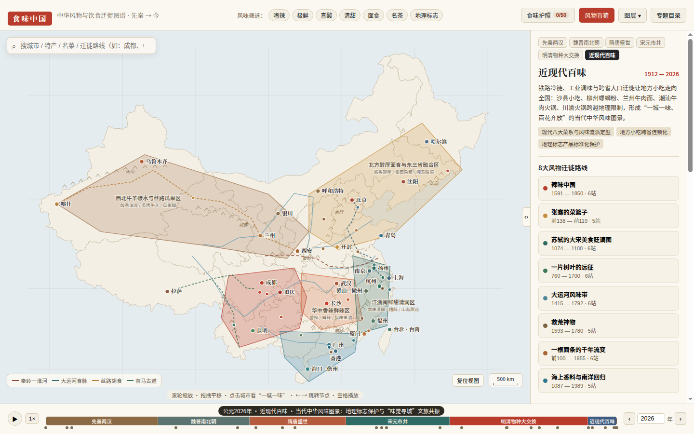
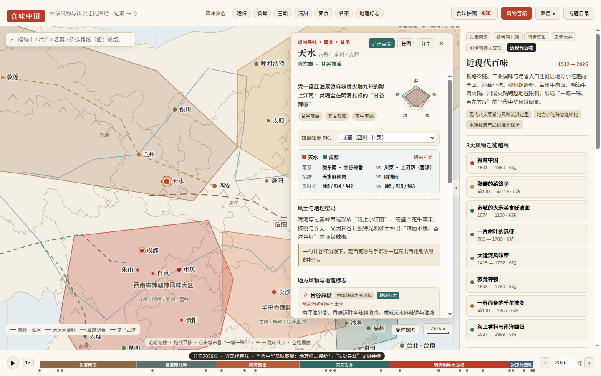
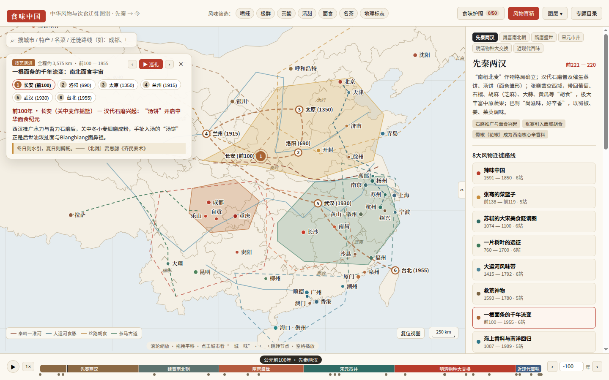

# 食味中国 · 中华风物与饮食迁徙图谱

<p align="left">
  <strong>简体中文</strong> · <a href="README_EN.md">English</a>
</p>

<p align="left">
  
  
  
  
  
</p>

**一幅可以拉动时间轴、点开每座城读「味觉千年史」、追踪辣椒/胡食/苏轼/茶马古道迁徙足迹的交互式中华风物与饮食舆图（先秦两汉 — 今）。**

👉 **在线演示：[https://yanglinzhen1022.github.io/flavors-of-china-migration-atlas/](https://yanglinzhen1022.github.io/flavors-of-china-migration-atlas/)**

- 纯静态原生 ES Modules + SVG 渲染，**零运行时依赖、无需构建打包**，开箱即跑，支持一键部署至 **GitHub Pages**。
- 收录 **58 座风味名城**、**174 项地理标志与传统风物**、**174 条历史沿革**、**6 大饮食时期**与 **8 条时空迁徙路线**。



---

## 这幅地图好玩在哪里？

### 1. 「点城寻味」一城一味档案 & 双城味觉 PK
点击地图上任意一座城市，展开它的专属风味志卡片：
* **五味风味雷达图**：直观量化每座城的 **鲜 / 辣 / 酸 / 甜 / 醇** 味觉坐标；
* **双城味觉 PK**：选择另一座城市（如 `天水 vs 成都`、`成都 vs 顺德`），双色叠加对比五味雷达、代表菜系与招牌美食；
* **风土密码与地标风物**：解释气候、水系与历史移民如何塑造当地口味，并列出国家地理标志（`地理标志` 徽章）与传统特产；
* **味觉千年演进**：例如成都明末以前并无辣椒、靠花椒生姜“好辛香”；点击历史年份即可让整幅地图瞬间穿越回当时的风味版图；
* **一键导出 PNG 长图**：无需第三方库，直接用 Canvas 生成高分辨率宣纸风味卡片用于社交分享。



---

### 2. 「循味迁徙」8 大物种、商道、技艺与食客行迹
以曲线弧线与编号站点重走改变中国人餐桌的 8 条时空动脉（支持自动巡礼播放与里程测算）：

| 路线 ID | 路线主题 | 时间跨度 | 核心看点 |
| :--- | :--- | :--- | :--- |
| `chili` | **辣味中国：辣椒入华与食辣版图重塑** | 1591 — 1850 | 杭州《遵生八笺》观赏盆景 → 贵州“以辣代盐” → 湘川麻辣定型 → 重庆码头牛油火锅 |
| `zhangqian` | **张骞的菜篮子：丝路胡食入华** | 前 138 — 前 119 | 葡萄、石榴、胡麻（芝麻）、大蒜、黄瓜、胡桃经河西走廊改变中原餐桌 |
| `sushi` | **苏轼的大宋美食贬谪图** | 1074 — 1100 | 杭州西湖 → 徐州 → 黄州《猪肉颂》东坡肉 → 惠州荔枝 → 儋州烤生蚝 |
| `tea_horse` | **一片树叶的远征：茶文化与茶马古道** | 760 — 1700 | 巴蜀蒙顶山 → 湖州陆羽《茶经》 → 建安点茶 → 普洱/雅安 → 拉萨酥油茶 |
| `canal` | **大运河风味带：漕运与南北味觉融合** | 1415 — 1792 | 杭州 → 苏州 → 扬州盐商淮扬菜 → 高邮咸鸭蛋 → 山东德州 → 北京烤鸭 |
| `sweet_potato` | **救荒神物：番薯与玉米的山海迁徙** | 1593 — 1780 | 福州陈振龙引种“金薯” → 泉州 → 江西/湖南/西南山地饮食重构 |
| `noodles` | **一根面条的千年流变：南北面食宇宙** | 前 100 — 1955 | 长安汉代“汤饼” → 洛阳 → 太原刀削面 → 兰州牛肉面 → 武汉热干面 → 台北眷村牛肉面 |
| `maritime` | **海上香料与南洋回归：闽粤港澳海洋味觉** | 1087 — 1989 | 泉州刺桐港 → 厦门沙茶面 → 广州十三行 → 香港丝袜奶茶 → 澳门土生葡菜 |



---

### 3. 宏观时间轴与「变迁残影」对照
* 覆盖 **先秦两汉、魏晋南北朝、隋唐盛世、宋元市井、明清物种大交换、近现代百味** 6 大历史时期与 24 个饮食史关键节点；
* 切换历史时期时自动在地图上保留上一阶段的**虚线残影（Ghost Diff）**，直观对比风味大区与食辣版图的盈亏扩张；
* 支持自由开关图层：**风味版图、变迁残影、食脉与分界（秦岭—淮河/大运河/丝路/茶马）、江河水系、山脉脊梁（秦岭/太行/祁连/横断/武夷等）、现代省界与省名**；
* 内置**统一多向锚点制图避让引擎**（4 级优先级 + 8 方向自动落位），在长三角、珠三角等高密度城市群依然保持字迹清晰不重叠。

---

### 4. 「食味护照」与「风味盲猜」互动挑战
* **我的食味护照**：在城市卡片点击「点亮」即可收集印章（本地 `localStorage` 持久化），自动统计七大区探索进度、实时计算你的**个人五味偏好画像**，并支持生成分享深链与导出 PNG 护照长图；
* **风味盲猜（古今风物小试）**：隐藏地图所有城市名，凭 3 条渐进风土与史料线索盲猜扎针，按大圆距离评分并授予「御膳大总管」「随园食客」等称号。

---

## 快捷键与直达深链协议（Deep Links）

### 常用快捷键
| 按键 | 功能 |
| :--- | :--- |
| **`/`** 或 **`Cmd/Ctrl + K`** | 聚焦全局搜索框（支持搜城市、古称、拼音、特产、名菜、迁徙路线与史事） |
| **`←` / `→`** | 跳往上一 / 下一历史节点，或路线模式下切换上一站 / 下一站 |
| **`Space`** | 自动播放 / 暂停时间轴（路线模式下自动巡礼） |
| **`Esc`** | 关闭当前弹窗卡片、护照或退出挑战模式 |

### 零坐标分享链接（URL 参数）
* **打开某座城市档案**：[`?city=chengdu`](https://yanglinzhen1022.github.io/flavors-of-china-migration-atlas/?city=chengdu) / [`?city=潮州`](https://yanglinzhen1022.github.io/flavors-of-china-migration-atlas/?city=%E6%BD%AE%E5%B7%9E) / [`?city=huangshan`](https://yanglinzhen1022.github.io/flavors-of-china-migration-atlas/?city=huangshan)
* **双城味觉 PK**：[`?city=tianshui&compare=chengdu`](https://yanglinzhen1022.github.io/flavors-of-china-migration-atlas/?city=tianshui&compare=chengdu) / [`?city=chengdu&compare=shunde`](https://yanglinzhen1022.github.io/flavors-of-china-migration-atlas/?city=chengdu&compare=shunde)
* **打开迁徙路线**：[`?route=chili`](https://yanglinzhen1022.github.io/flavors-of-china-migration-atlas/?route=chili) / [`?route=noodles`](https://yanglinzhen1022.github.io/flavors-of-china-migration-atlas/?route=noodles) / [`?route=sushi`](https://yanglinzhen1022.github.io/flavors-of-china-migration-atlas/?route=sushi)
* **按风味一键筛选**：[`?flavor=辣`](https://yanglinzhen1022.github.io/flavors-of-china-migration-atlas/?flavor=%E8%BE%A3) / [`?flavor=鲜`](https://yanglinzhen1022.github.io/flavors-of-china-migration-atlas/?flavor=%E9%B2%9C) / [`?flavor=茶`](https://yanglinzhen1022.github.io/flavors-of-china-migration-atlas/?flavor=%E8%8C%B6) / [`?flavor=gi`](https://yanglinzhen1022.github.io/flavors-of-china-migration-atlas/?flavor=gi)
* **分享已点亮美食足迹**：[`?visited=chengdu,xian,shunde,huangshan`](https://yanglinzhen1022.github.io/flavors-of-china-migration-atlas/?visited=chengdu,xian,shunde,huangshan)
* **直接开启盲猜挑战**：[`?quiz=flavor`](https://yanglinzhen1022.github.io/flavors-of-china-migration-atlas/?quiz=flavor)
* **网页嵌入模式（Iframe）**：
  ```html
  <iframe
    src="https://yanglinzhen1022.github.io/flavors-of-china-migration-atlas/?embed=1&route=chili"
    width="100%" height="520" loading="lazy" style="border:0"
    title="食味中国 · 辣味中国迁徙路线"></iframe>
  ```

---

## AI Agent & MCP 接入指南

项目原生支持作为大语言模型与 AI Agent 的**中华风物与饮食地理工具**：
* **机器可读说明文档**：[`llms.txt`](llms.txt)
* **零依赖本地 MCP Server (`stdio`)**：[`scripts/mcp_server.js`](scripts/mcp_server.js)，可直接配置到 Claude Desktop、Cursor、Windsurf 或 Gemini CLI：
  ```json
  {
    "mcpServers": {
      "shiwei-atlas": {
        "command": "node",
        "args": ["/absolute/path/to/shiwei-atlas/scripts/mcp_server.js"]
      }
    }
  }
  ```
  提供 3 个工具：`inspect_city_flavor({ city })`、`inspect_food_route({ route })`、`search_culinary_atlas({ query, limit? })`。
* **浏览器端 API & WebMCP**：页面自动挂载 `window.shiweiAPI`（`locate` / `inspect` / `search` / `listCities`），并在支持 WebMCP（`navigator.modelContext`）的浏览器中自动注册 `shiwei_locate_city` 与 `shiwei_open_route`。

---

## 本地运行与部署

### 1. 本地运行（零依赖）
```bash
git clone https://github.com/yanglinzhen1022/flavors-of-china-migration-atlas.git
cd flavors-of-china-migration-atlas
npm run serve
# 或 python3 -m http.server 8088
```
浏览器访问 `http://localhost:8088`。

### 2. 一键部署至 GitHub Pages
仓库已内置 [`.github/workflows/deploy-pages.yml`](.github/workflows/deploy-pages.yml)：
1. 将代码推送至 GitHub 仓库的 `main` 分支；
2. 进入仓库 **Settings → Pages → Build and deployment**，将 **Source** 设为 **GitHub Actions**；
3. 每次推送会自动执行构建、数据校验、集成测试并发布至 `https://yanglinzhen1022.github.io/flavors-of-china-migration-atlas/`。

### 3. Docker 部署
```bash
docker compose up -d --build
```
随后访问 `http://localhost:8088`（基于 `nginx:alpine` 纯静态托管）。

---

## 项目结构与开发命令

```text
shiwei-atlas/
├── index.html                  # 主入口（响应式桌面/移动端抽屉）
├── css/style.css               # 宣纸设色视觉体系
├── data/
│   ├── cities/*.json           # 58 座城市独立风物 JSON（便于社区 PR 扩充）
│   ├── cities_bundle.json      # 构建脚本自动生成的单文件汇总包
│   ├── eras.json               # 6 大时期、24 个节点与动态风味大区多边形
│   ├── routes.json             # 8 条物种/商道/食客迁徙路线
│   └── geo/                    # 34 省简化边界 + 江河/古道/山脉脊梁
├── src/
│   ├── core/                   # 墨卡托投影、全域检索、URL 深链状态
│   ├── map/                    # 相机控制（rAF/双指捏合）、SVG 渲染与 8 向避让引擎
│   ├── ui/                     # 城市卡片、双城 PK、食味护照、盲猜、Canvas 长图导出
│   └── api/                    # window.shiweiAPI & WebMCP 注册
├── scripts/
│   ├── build_bundle.js         # 打包城市数据并生成 67 个静态 SEO 专题页
│   ├── validate_atlas.js       # 坐标、年代、字段与引用完整性校验
│   ├── test_e2e.js             # 投影、检索、深链与 MCP 协议自动化测试
│   └── mcp_server.js           # 零依赖 Stdio JSON-RPC 2.0 MCP 服务
└── topics/                     # 67 个静态图文专题页（SEO 友好）
```

常用开发与校验命令：
```bash
npm run build      # 打包 data/cities_bundle.json 并生成 topics/ 静态专题页
npm run validate   # 校验全部城市、路线、地理坐标与史料完整性
npm test           # 运行投影、检索、深链、SEO 与 MCP 集成测试
```

---

## 参与贡献与数据说明

* **欢迎贡献家乡风味**：新增一座城市只需在 `data/cities/` 下添加一个 JSON 文件并运行 `npm run build && npm run validate && npm test`，详见 [CONTRIBUTING.md](CONTRIBUTING.md)。
* **数据来源**：
  * 历史食单与典故整理自公有领域古籍（《齐民要术》《华阳国志》《东京梦华录》《梦粱录》《饮膳正要》《遵生八笺》《随园食单》等）；
  * 地方特产与传统技艺参照国家地理标志保护产品与非物质文化遗产公开名录整理；
  * 省级行政区轮廓源自阿里云 DataV GeoAtlas 并经 Douglas-Peucker 简化（仅作文化地理示意，非精确测绘边界）。

License: [MIT](package.json)
