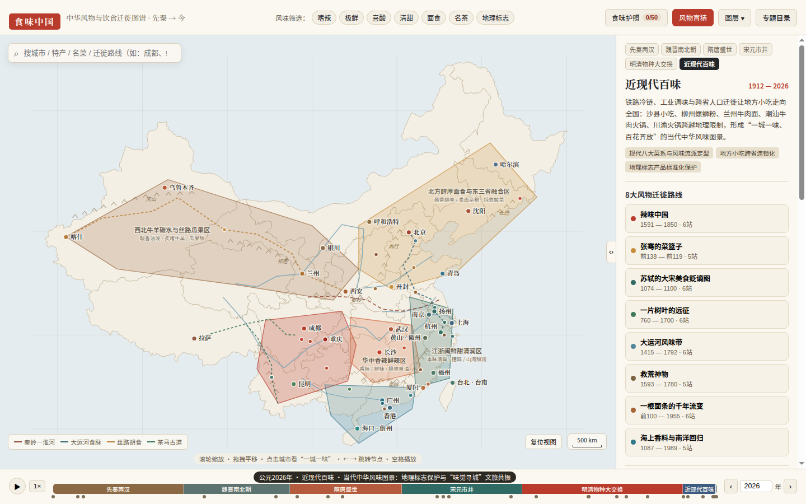
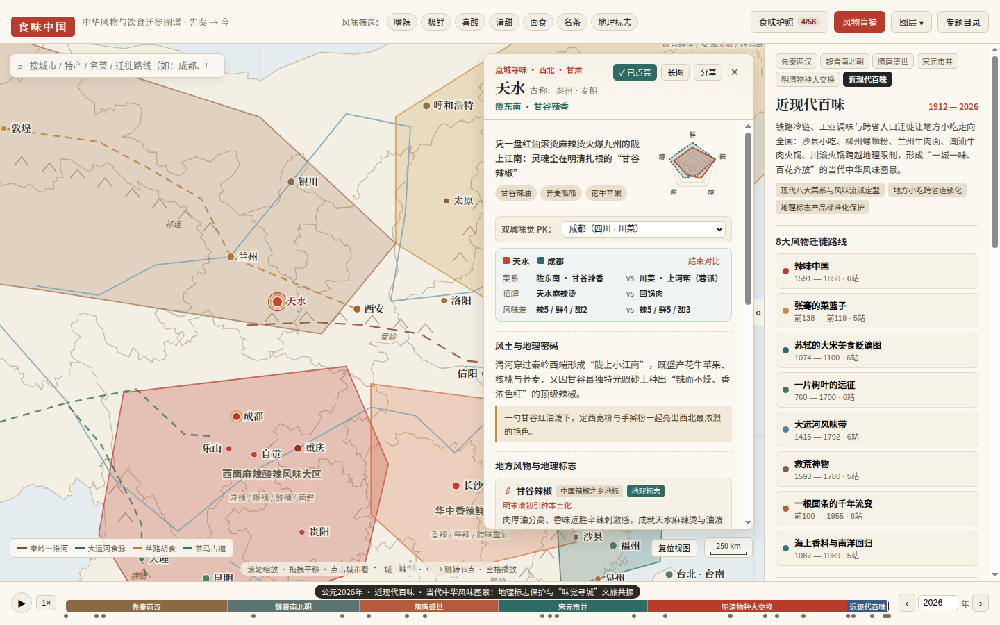
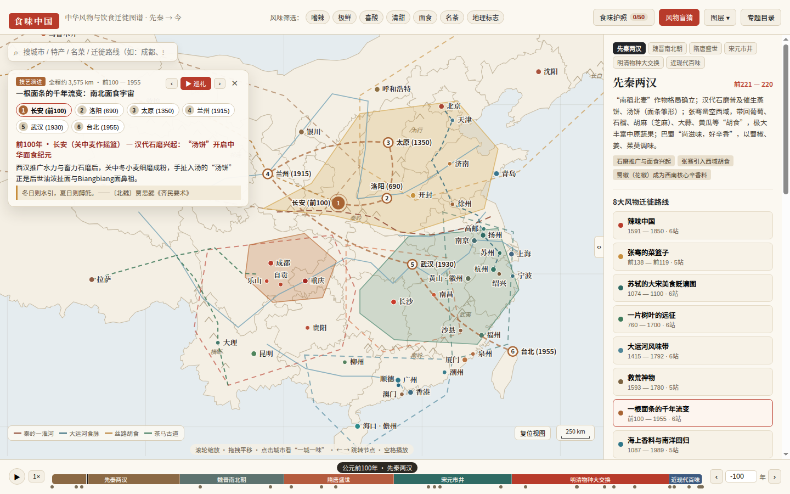

# Flavors of China · Culinary & Local Specialties Migration Atlas (食味中国)

<p align="left">
  <a href="README.md">简体中文</a> · <strong>English</strong>
</p>

<p align="left">
  
  
  
  
  
</p>

**An interactive historical & geographic atlas of Chinese cuisine, local specialties, and crop/flavor migrations from the Qin–Han era (221 BCE) to the present.**

👉 **Live Demo: [https://yanglinzhen1022.github.io/flavors-of-china-migration-atlas/](https://yanglinzhen1022.github.io/flavors-of-china-migration-atlas/)**

- Pure static native ES Modules + SVG cartography — **zero runtime dependencies, zero bundler required**, ready for instant deployment on **GitHub Pages**.
- Curates **58 iconic culinary cities**, **174 Geographical Indication (GI) & heritage specialties**, **174 historical taste milestones**, **6 culinary eras**, and **8 spatio-temporal migration routes**.



---

## Key Features

### 1. City Culinary Profiles & Dual-City Taste PK
Click any city on the parchment map to inspect its **City Flavor Genealogy Card**:
* **5-Axis SVG Flavor Radar**: Visualizes each city's profile across **Umami (鲜), Spicy (辣), Sour (酸), Sweet (甜), and Rich/Savory (醇)**;
* **Dual-City Taste PK**: Overlay a second city (e.g., `Tianshui vs Chengdu` or `Chengdu vs Shunde`) on the same radar chart to compare cuisine families, signature dishes, and flavor scores side by side;
* **Terroir & Local Specialties**: Explains the geography, climate, and historical migrations behind local tastes, with Geographical Indication (`地理标志`) badges and hand-crafted SVG category icons;
* **Millennia of Taste Evolution**: Trace how a city's palate changed over centuries (e.g., Chengdu relied on Sichuan peppercorn and ginger for two millennia before chili peppers arrived in the late Ming/Qing) — click any historical year to jump the map timeline directly to that era;
* **One-Click PNG Share Poster**: Zero-dependency HTML5 Canvas exporter generates high-resolution parchment cards for social sharing.



---

### 2. Eight Spatio-Temporal Food & Crop Migration Routes
Follow animated curved arcs and numbered historical stops across China (with autoplay tour and great-circle distance calculation):

| Route ID | Theme | Time Span | Highlights |
| :--- | :--- | :--- | :--- |
| `chili` | **Spicy China: How Chili Reshaped Regional Cuisines** | 1591 – 1850 | Hangzhou ornamental plant (*Zunsheng Bajian*) → Guizhou "salt substitute" → Hunan & Sichuan *mala* → Chongqing hotpot |
| `zhangqian` | **Zhang Qian's Silk Road Basket** | 138 – 119 BCE | Grapes, pomegranates, sesame, garlic, cucumber, and walnuts arriving via the Hexi Corridor |
| `sushi` | **Su Shi's Song Dynasty Gourmet Exile** | 1074 – 1100 | Hangzhou → Xuzhou → Huangzhou (*Dongpo Pork*) → Huizhou lychees → Danzhou grilled oysters |
| `tea_horse` | **Journey of a Leaf: Tea Culture & Tea-Horse Road** | 760 – 1700 | Bashu origins → Huzhou (*Classic of Tea*) → Jian'an whisked tea → Pu'er & Ya'an → Lhasa butter tea |
| `canal` | **Grand Canal Culinary Corridor** | 1415 – 1792 | Hangzhou → Suzhou → Yangzhou salt-merchant Huaiyang cuisine → Gaoyou salted duck eggs → Dezhou → Peking duck |
| `sweet_potato` | **Famine Saviors: Sweet Potato & Maize** | 1593 – 1780 | Chen Zhenlong smuggling sweet potato vines to Fuzhou → transforming highland diets across Jiangxi, Hunan & Yunnan |
| `noodles` | **A Thousand Years of Noodles** | 100 BCE – 1955 | Chang'an Han-era *tangbing* → Luoyang → Taiyuan knife-cut noodles → Lanzhou beef noodles → Wuhan hot dry noodles → Taipei beef noodle soup |
| `maritime` | **Maritime Spices & Nanyang Return** | 1087 – 1989 | Quanzhou maritime Silk Road → Xiamen *shacha* noodles → Guangzhou Thirteen Factories → Hong Kong milk tea → Macau Macanese cuisine |



---

### 3. Interactive Timeline with Ghost Diff & Cartographic Clarity
* Scrub across **6 culinary eras** (Qin–Han, Wei–Jin, Sui–Tang, Song–Yuan, Ming–Qing Columbian Exchange, Modern China) and **24 milestones**;
* **Ghost Diff**: Switching eras leaves a dashed outline of the previous era's flavor zones so shifts (like the expansion of chili-eating regions) are immediately visible;
* Toggleable layers: Flavor Zones, Ghost Diff, Culinary Corridors & Qinling–Huaihe Divide, Major Rivers, Mountain Ridges (Qinling, Taihang, Qilian, Hengduan, Wuyi, etc.), and Modern Provinces;
* **8-Direction Multi-Anchor Label Collision Engine**: Automatically places city, route, zone, and mountain labels without overlap even in dense clusters like the Yangtze and Pearl River Deltas.

---

### 4. Personal "Culinary Passport" & Blind-Map Quiz
* **Culinary Passport (`食味护照`)**: Stamp cities you've visited (saved in `localStorage`), track completion across China's 7 regions, view your dynamically computed personal 5-axis taste profile, share via URL (`?visited=...`), or export a PNG passport poster;
* **Flavor Blind-Guess Quiz (`风味盲猜`)**: Hides all city labels and gives 3 progressive terroir/historical clues; drop a pin on the blank map to score by great-circle distance and earn a traditional culinary rank.

---

## Keyboard Shortcuts & Deep-Link Protocol

### Shortcuts
| Key | Action |
| :--- | :--- |
| **`/`** or **`Cmd/Ctrl + K`** | Focus unified search (cities, ancient names, pinyin, specialties, dishes, routes, milestones) |
| **`←` / `→`** | Step to previous / next timeline milestone or route stop |
| **`Space`** | Toggle timeline or route autoplay |
| **`Esc`** | Close active card, passport modal, or quiz |

### Zero-Coordinate Deep Links
* **City Profile**: [`?city=chengdu`](https://yanglinzhen1022.github.io/flavors-of-china-migration-atlas/?city=chengdu) / [`?city=huangshan`](https://yanglinzhen1022.github.io/flavors-of-china-migration-atlas/?city=huangshan) / [`?city=shunde`](https://yanglinzhen1022.github.io/flavors-of-china-migration-atlas/?city=shunde)
* **Dual-City Taste PK**: [`?city=tianshui&compare=chengdu`](https://yanglinzhen1022.github.io/flavors-of-china-migration-atlas/?city=tianshui&compare=chengdu)
* **Migration Route**: [`?route=chili`](https://yanglinzhen1022.github.io/flavors-of-china-migration-atlas/?route=chili) / [`?route=noodles`](https://yanglinzhen1022.github.io/flavors-of-china-migration-atlas/?route=noodles) / [`?route=sushi`](https://yanglinzhen1022.github.io/flavors-of-china-migration-atlas/?route=sushi)
* **Flavor Filter**: [`?flavor=辣`](https://yanglinzhen1022.github.io/flavors-of-china-migration-atlas/?flavor=%E8%BE%A3) / [`?flavor=gi`](https://yanglinzhen1022.github.io/flavors-of-china-migration-atlas/?flavor=gi)
* **Shared Passport Footprint**: [`?visited=chengdu,xian,shunde,huangshan`](https://yanglinzhen1022.github.io/flavors-of-china-migration-atlas/?visited=chengdu,xian,shunde,huangshan)
* **Blind-Guess Quiz**: [`?quiz=flavor`](https://yanglinzhen1022.github.io/flavors-of-china-migration-atlas/?quiz=flavor)
* **Iframe Embed Mode**:
  ```html
  <iframe
    src="https://yanglinzhen1022.github.io/flavors-of-china-migration-atlas/?embed=1&route=chili"
    width="100%" height="520" loading="lazy" style="border:0"
    title="Flavors of China - Chili Migration Route"></iframe>
  ```

---

## AI Agent & MCP Integration

* **Machine-readable guide**: [`llms.txt`](llms.txt)
* **Zero-dependency Stdio MCP Server**: [`scripts/mcp_server.js`](scripts/mcp_server.js) — plug directly into Claude Desktop, Cursor, Windsurf, or Gemini CLI:
  ```json
  {
    "mcpServers": {
      "shiwei-atlas": {
        "command": "node",
        "args": ["/absolute/path/to/flavors-of-china-migration-atlas/scripts/mcp_server.js"]
      }
    }
  }
  ```
  Exposes 3 tools: `inspect_city_flavor({ city })`, `inspect_food_route({ route })`, and `search_culinary_atlas({ query, limit? })`.
* **Browser JS API & WebMCP**: Exposes `window.shiweiAPI` (`locate`, `inspect`, `search`, `listCities`) and registers `shiwei_locate_city` / `shiwei_open_route` when `navigator.modelContext` is available.

---

## Local Development & Deployment

### Run Locally (Zero Build Step)
```bash
git clone https://github.com/yanglinzhen1022/flavors-of-china-migration-atlas.git
cd flavors-of-china-migration-atlas
npm run serve
# or python3 -m http.server 8088
```
Open `http://localhost:8088` in your browser.

### Build, Validate & Test
```bash
npm run build      # Bundle data/cities/*.json and generate 67 static SEO pages in topics/
npm run validate   # Validate schemas, coordinates, eras, and route references
npm test           # Run projection, search, deep-link, SEO, and MCP integration tests
```

### Deploy via GitHub Pages or Docker
- **GitHub Pages**: Push to `main` and set **Settings → Pages → Source** to **GitHub Actions** ([`.github/workflows/deploy-pages.yml`](.github/workflows/deploy-pages.yml)).
- **Docker**: Run `docker compose up -d --build` and visit `http://localhost:8088`.

---

## Contributing & Data Attribution

* Adding a new city only requires creating a JSON file under `data/cities/<id>.json` and running `npm run build && npm run validate && npm test`. See [CONTRIBUTING.md](CONTRIBUTING.md).
* **Sources**: Public-domain classical Chinese culinary & agricultural texts (*Qimin Yaoshu*, *Dongjing Menghua Lu*, *Yinshan Zhengyao*, *Suiyuan Shidan*, etc.), public National Geographical Indication & Intangible Cultural Heritage registries, and simplified provincial outlines derived from Alibaba Cloud DataV GeoAtlas (for cultural illustration only, not surveyed borders).

License: [MIT](package.json)
